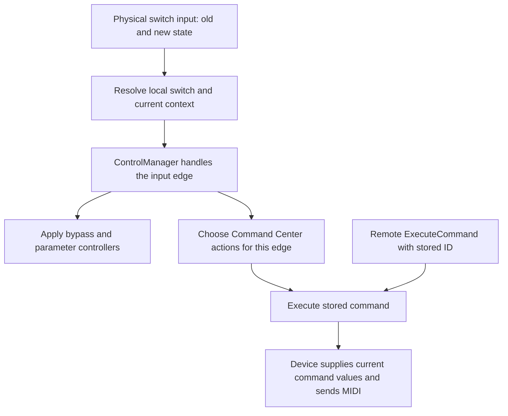

# Stomp firmware trace: a working stored-command route

**The Stadium can remotely execute an existing Command Center assignment by
its stored command ID.** The case-sensitive editor request is
`/ExecuteCommand`. A live test ran both commands attached to Stomp B1 and
captured both configured USB MIDI messages. Repeating the pair worked, and a
changed device-side value was used by the same ID-only request.

This updates the earlier [remote Stomp investigation](REMOTE_STOMP_TRIGGER_RESEARCH.md).
That investigation tested the lowercase `/executeCommand` notification as an
input and missed the separate capitalized request. It also overstated what
`SourceEnableSet` changed; the correction is below.

## Physical input path

The local trace used the extracted public **1.4.0.1341** `p35-server` binary:

```
SHA-256: 3bd85e9ec2e2f66d47f6c6d4a66a98874b71f16200011ad919214c68cf8b54fe
```

Function addresses below are ELF virtual addresses, before relocation. The
local Ghidra project adds `0x100000` to these addresses. Decompiled output was
checked against AArch64 instructions and unwind-table function boundaries;
it is not original source code.



The trace separates four operations:

- `/stomp` serializes a `ComponentValue` containing component identity and old
  and new input states (`0x5afe14`). The event registration is at `0x5b2ae0`;
  the messenger callback at `0x69da30` forwards the value to its event delegate.
- The `HXEditBuffer::ControlManager` dispatcher wrapper (`0x354b70`, with its
  interface thunk at `0x354ca0`) resolves the local component's current
  context, then calls the shared handler at `0x3532a4`. RTTI identifies its
  `HXIO::ControlDispatcher` base. Source lookup (`0x3489b0`) includes both the
  local ID and context.
- The shared handler decodes state transitions, checks source enablement,
  processes assigned controllers and separately iterates the source's command
  assignments. Press, release and hold are distinct conditions. Its command
  branch reaches the stored-command executor at `0x375880`.
- That executor dispatches through the command's entity proxy. The server's
  execution handler (`0x5e9a10`) looks up a stored command, updates runtime
  toggle state, applies action-specific checks and dispatches it through
  `0x481d20`. The MIDI command type uses handler `0x444574`.

The captured hardware component `0x01190201` should not be treated as a packed
Stomp B source ID. The input handler reads a component type and local switch
number from it, then resolves context separately. The assignment graph still
identifies B1 as source type 1, local 25, context 2.

The outgoing event stream remains distinct from the editor command inlet.
Finding the physical handler does not make `/stomp` a callable editor request.
No internal service was exposed or modified during this work.

## The missed request

The firmware has both names, with different purposes:

| Address | Role |
| --- | --- |
| `/ExecuteCommand` | Editor request to execute one stored Command Center command |
| `/executeCommand` | Notification that command execution occurred; also the response address |

The capitalized request has a serializer at `0x4e2be0`, is registered in the
same server dispatcher as ordinary editor commands at `0x5c94f8`, and reaches
handler `0x5e9a10`. `Craft::ExecuteCommand` (`0x67e110`) constructs it.

The earlier generated handler-name inventory omitted this custom registration.
Its absence from that inventory was not evidence that the request was absent.

Wire shape:

```
/ExecuteCommand ,ii [request_id, stored_command_id]
```

Successful command-port response observed:

```
/executeCommand [request_id, stored_command_id, 0]
```

The event stream additionally announces the execution with the client origin,
request ID, command ID and runtime state. The originating client differs from a
physical press; matching the physical origin number is not required.

## Hardware verification

Tests used a fresh temporary preset, `HELYON Stored Command Test`, with B1's
two Command Center entries set to Press. Requests were issued through the same
network client used by the mobile app. The request arguments contained only
the command ID, never a MIDI channel, CC number or value.

| Check | Result |
| --- | --- |
| Execute B1 command 1 | Response `[3, 1, 0]`; USB `BF 77 49` |
| Execute B1 command 2 | Response `[5, 2, 0]`; USB `BE 76 4A` |
| Repeat IDs 1 then 2, awaiting each response | Both messages again, in order; about 9 ms between captured messages |
| Change command 1's CC value from 73 to 81 without saving, then execute ID 1 | USB `BF 77 51`; the device used its current assignment value |

Each executed command also produced its `/executeCommand` event. Runtime
`togl` state changed on execution; the repeated pair changed it back. The
value was restored to 73 after the unsaved-value test. Command configuration
matched the initial test configuration before cleanup.

This verifies five individual stored-command executions, including two runs
of the existing two-command group. It does not verify snapshot-dependent
values, delayed commands, Release/Hold actions, Toggle alternation or mixing
physical and remote presses. Five-pin MIDI Out remains unmeasured.

## What can be built from this

For two existing **Press** commands, the phone can read the selected Stomp B
source's `cmds` list and execute those stored IDs in slot order. The Stadium
supplies their settings and MIDI output. There is no need to maintain a second
MIDI configuration in HELYON.

This is not a single firmware request that presses the entire switch. Bypass
and parameter assignments are separate. A button must not silently skip them
or present a command-only operation as a complete physical switch press.

A production implementation needs preset/source identity checks, action-aware
dispatch, confirmation of current snapshot values and explicit partial-failure
handling. Two requests are not atomic: if one succeeds and the next fails,
report the partial result and do not automatically retry. Release, Hold and
Toggle need physical-reference tests before being enabled.

Claude reviewed the observed protocol evidence and these implementation
constraints. The local binary trace was performed separately after Claude had
declined direct disassembly work.

## Correction: source enablement

The previous follow-up described `/SourceEnableSet [25, 2, state]` as changing
B1's bypass group. Exact comparisons of those saved readbacks show that it
changed **only** `cg__.entt.srcs[].byps`; the signal-flow graph was unchanged.
The firmware trace checks this source flag before processing input. It is an
assignment-source gate, not a synthetic footswitch press.

`/ControllerValueSet` on the mapped controller did change Deluxe Comp bypass.
That separate result remains valid, but it did not execute Command Center
commands or establish full switch behaviour.

## Cleanup and artifacts

Temporary preset 933 was removed. The original preset and snapshot were
restored, all 165 occupied User slots and four setlists matched the starting
state, and the original preset bytes were unchanged. No unsaved changes
remained. No firmware or application release was deployed.

Local traces, decompiler output, MIDI captures, request results and Claude's
review are under `.codex-artifacts/stomp-firmware-trace/`. The Ghidra project is
under `generated/firmware/stomp-activation-trace/`. Both locations are ignored
by Git. App Stomp controls remain read-only pending implementation and the
remaining behaviour checks.
